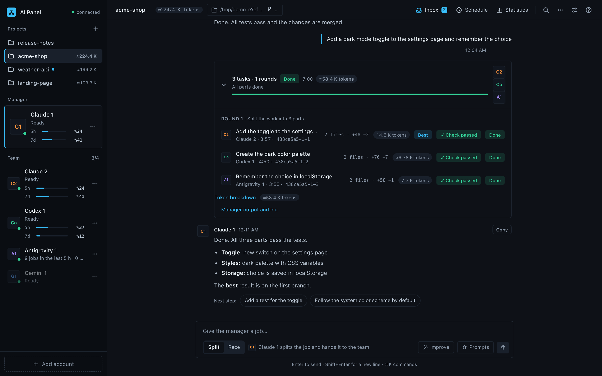
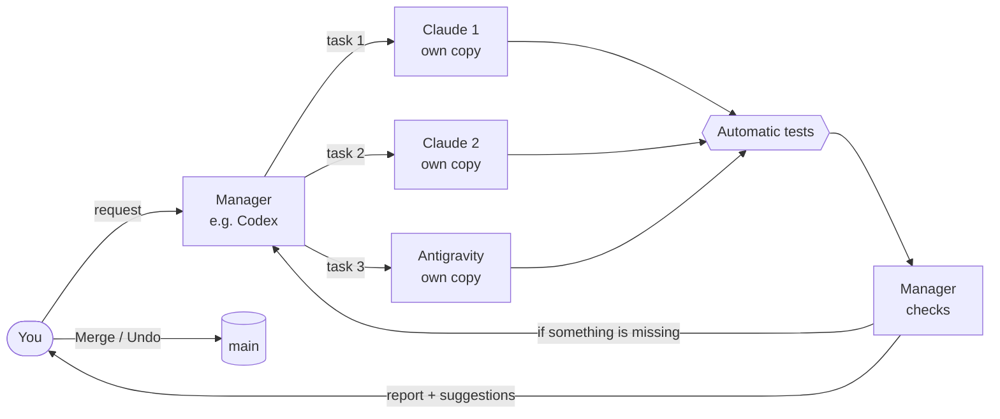
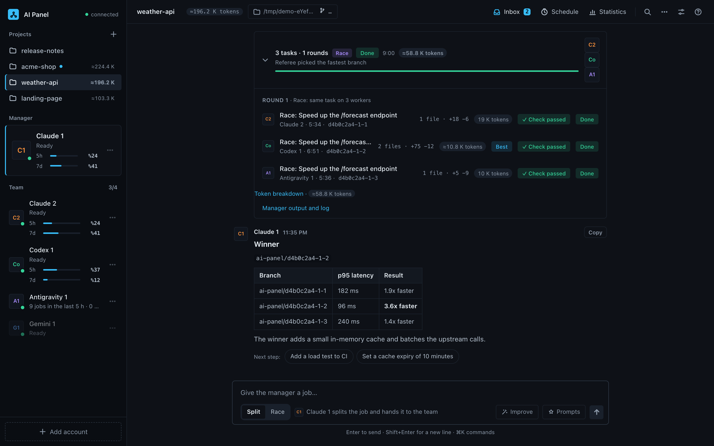
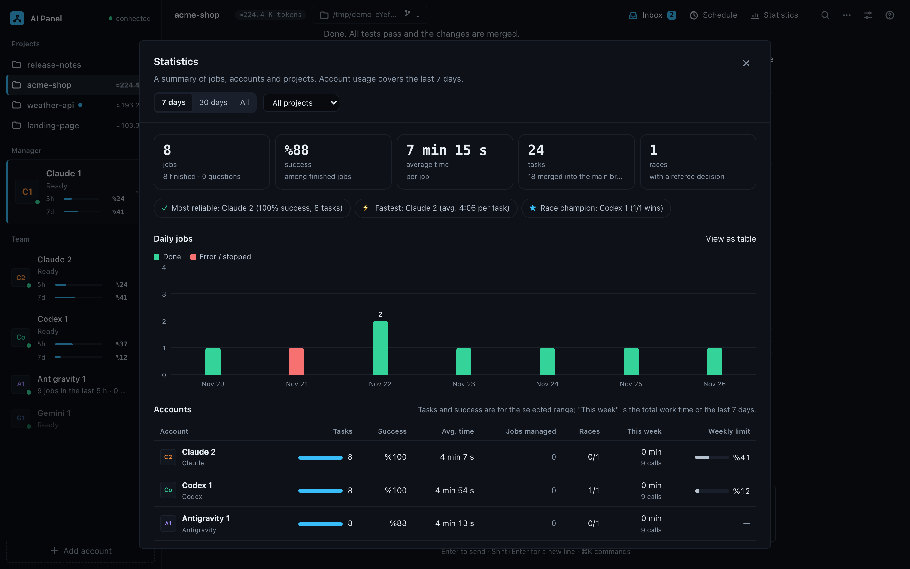
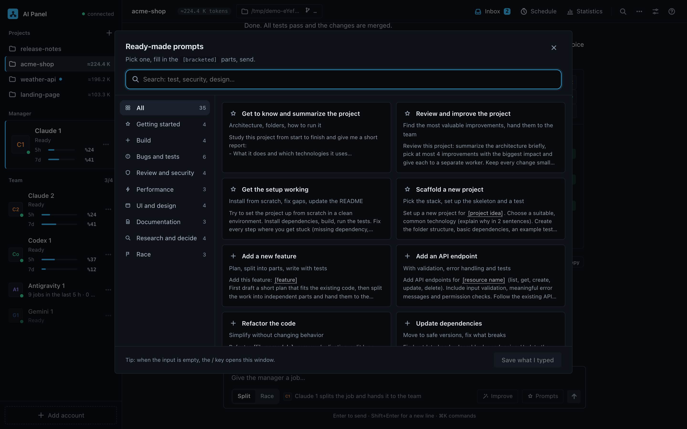
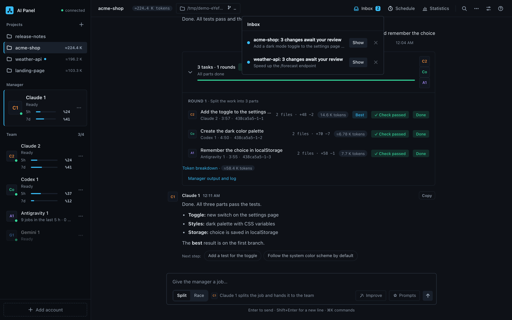
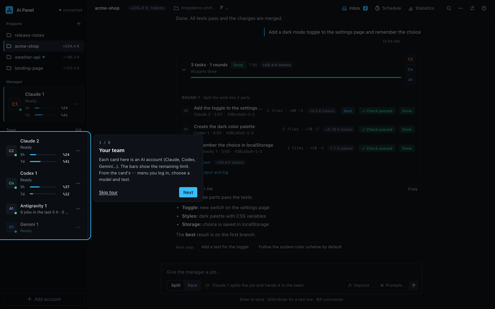
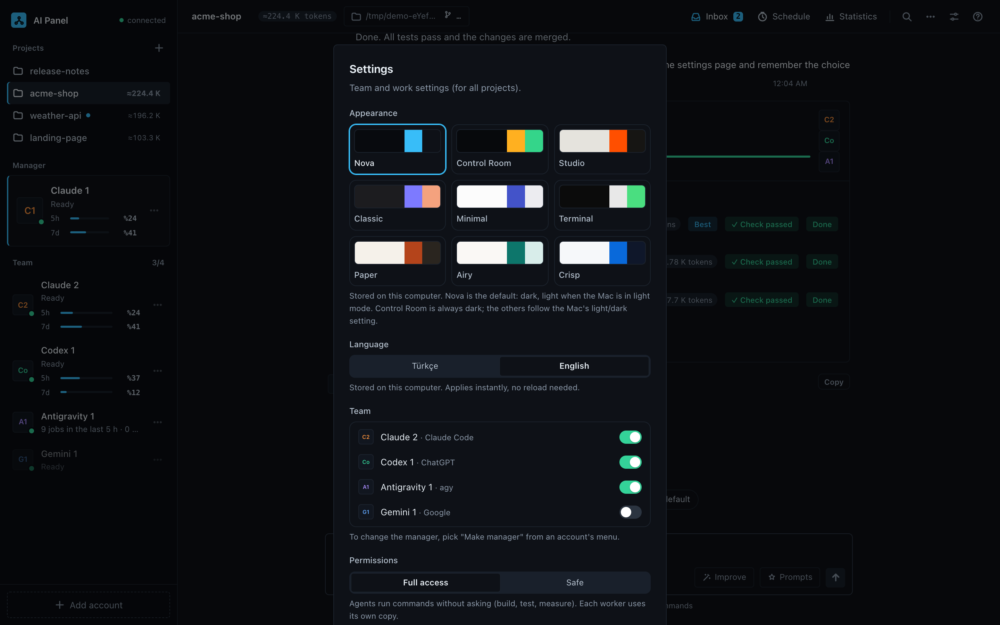
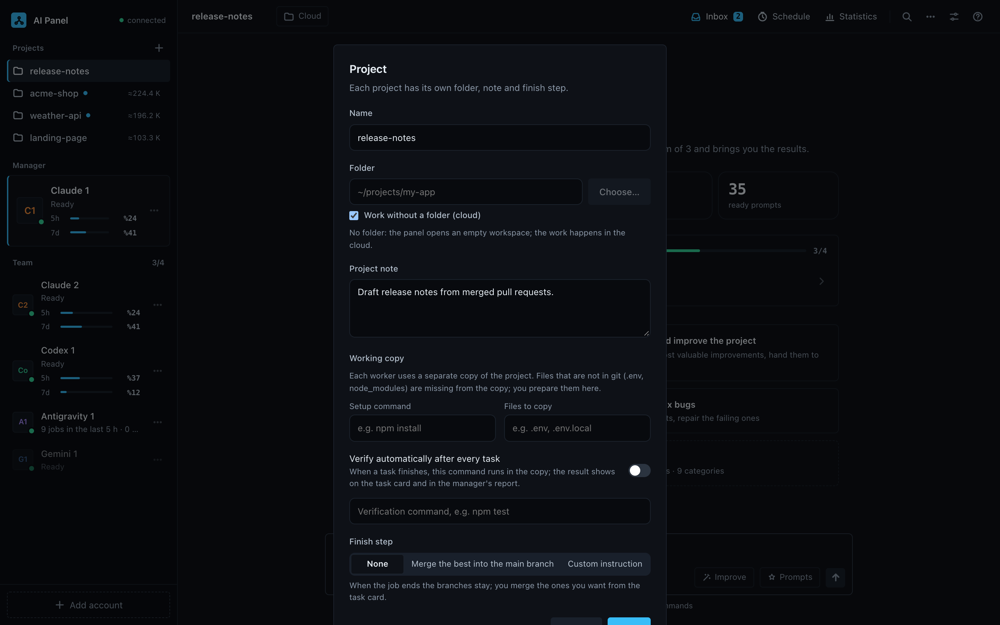

<div align="center">

English | [Türkçe](README.tr.md)

# AI Panel

**Run all your AI coding accounts as one team.**
A manager splits the job, workers run in parallel on their own copies of your project, and tests run automatically.
All that's left for you is to review the result and say "merge".


Claude Code · Codex · Antigravity · Gemini CLI



</div>

---

## Why?

If you pay for more than one AI subscription, you probably know these problems:

- Every tool lives in its own terminal or tab. Keeping track of which one has finished and which one is waiting for you is tiring.
- When one account hits its limit, the work stalls while the other accounts sit idle.
- Two agents in the same folder overwrite each other's changes.
- An agent says "done", and you still have to check whether the tests really pass.

AI Panel manages all your accounts as **one team**. You describe what you want. The manager breaks the job into parts and hands them to the least-loaded workers. Each worker runs in its **own git copy** of the project. At the end the tests run, the manager checks the results, and you get a short report.

## Highlights

| | |
|---|---|
| **Split or Race** | Split a job into parts and spread them across the team, or give everyone the same task and let the manager referee, measure and pick the best result. |
| **Separate working copies** | Every worker uses its own `git worktree` and branch, so nobody overwrites anybody else's files. |
| **Automatic verification** | When a task finishes, the project's test command runs in that copy. The card shows a pass or fail mark and the manager decides based on it. |
| **One-click merge and undo** | Merge the branch you like. If you regret it, hit **Undo** and you are back where you were. |
| **Limit awareness** | Claude and Codex limits are read without spending any quota. An account at its limit gets no work; the job moves to an idle account. If everyone is at the limit, the panel waits and continues where it stopped. |
| **Inbox** | Everything that needs your decision in one list: changes to review, failed tests, accounts that need a login or have hit a limit. |
| **Smart helpers** | 35 ready-made prompts, an **Improve** button that sharpens what you typed (it reads the last answer in the chat, marks at most two open questions with defaults, can be cancelled and undone), "next step" suggestions after a job, and a project scanner that detects the stack and test command. |
| **Folderless (cloud) projects** | Tick **Work without a folder (cloud)** and the panel opens an empty workspace for remote work. See below. |
| **Token usage** | Every task, manager round and job shows the tokens it used; project totals sit in the top bar. See [Token usage](#token-usage). |
| **Start new chat** | When a chat gets long, a tip offers to start a new one that begins with a short summary. The manager's history is also leaner (see `docs/token-gecmis.md`). |
| **Persistent queue** | Queued messages survive a panel restart. They wait until you press **Resume queue** (or send a new message). |
| **One-click restart** | An "Update ready." banner and a Settings button restart the panel; the page reloads itself. |
| **Reasoning effort per account** | Pick how hard each account thinks, from Low to Max. |
| **Scheduled tasks** | Set up a job such as "check dependencies every morning at 09:00" once and the panel starts it on time. |
| **Statistics** | Daily job chart, success rate and average time per account, race champion, weekly limit warnings. |
| **Nine themes** | Nova (default: dark with a single blue accent, light when the Mac is in light mode), Control Room, Studio, Classic, Minimal, Terminal, Paper, Airy and Crisp. |
| **Turkish / English UI** | Choose it in Settings → Appearance → Language. It switches without a page reload and covers the interface, help, ready-made prompts and error messages. |
| **Zero dependencies** | Just Node.js. No `npm install`, no build step. |

## How it works



1. **Write.** Type what you want, or pick a ready-made prompt.
2. **The manager plans.** A question gets answered directly. A job gets split into parts and handed to the workers with the most headroom.
3. **Workers work.** Each one runs on an `ai-panel/...` branch in its own copy of the project. The sidebar shows what each one is doing right now (`› Bash: npm test`).
4. **Verification.** The test command runs in every copy. If needed, the manager starts another round.
5. **You decide.** Review the diff, then merge or undo. By default nothing reaches your main branch without your approval (you can switch this to automatic).

## Screenshots

<table>
<tr>
<td width="50%"></td>
<td width="50%"></td>
</tr>
<tr>
<td><b>Race mode.</b> The same task went to three workers. The fastest solution was eliminated because it broke the tests; the winner was picked by measurement.</td>
<td><b>Statistics.</b> Daily jobs, success and time per account, race wins, weekly usage.</td>
</tr>
<tr>
<td></td>
<td></td>
</tr>
<tr>
<td><b>Prompt library.</b> 35 job recipes in 9 categories. Open it from the Prompts button next to the input, or press <kbd>/</kbd> when the input is empty. Fill in the <code>[bracketed]</code> parts and send.</td>
<td><b>Inbox.</b> Everything waiting for your decision in one list. "Show" takes you to the job.</td>
</tr>
<tr>
<td></td>
<td></td>
</tr>
<tr>
<td><b>First-run tour.</b> A short walkthrough of the screen the first time you open the panel. You can start it again from the <kbd>?</kbd> button.</td>
<td><b>Themes.</b> Nine themes, changed in Settings → Appearance. Default: Nova. If you picked a theme earlier, your choice is kept.</td>
</tr>
<tr>
<td colspan="2"></td>
</tr>
<tr>
<td colspan="2"><b>Folderless (cloud) project.</b> Tick <i>Work without a folder (cloud)</i> and the panel opens an empty workspace for remote work.</td>
</tr>
</table>

> The projects, tasks and numbers in the screenshots are sample data.

## Installation (Mac)

1. Install [Node.js](https://nodejs.org) (the LTS version is enough).
2. Install the AI tools you use:
   ```bash
   npm install -g @anthropic-ai/claude-code @openai/codex @google/gemini-cli
   curl -fsSL https://antigravity.google/cli/install.sh | bash
   ```
   The last line installs the Antigravity CLI (`agy`).
3. Start the panel:
   ```bash
   cd ai-hub
   npm start
   ```
   The panel opens in its own window (without an address bar if Chrome, Edge, Brave or Arc is installed).
4. **Optional:** add it to the Dock:
   ```bash
   npm run app
   ```
   This creates `~/Applications/AI Panel.app`. Drag it to the Dock and open it with one click from then on. If the panel is already open, clicking the icon brings the existing window to the front instead of opening a new one (Chrome, Edge, Brave, Arc; macOS may ask for automation permission the first time).

## First steps

A short tour introduces the screen the first time you open the panel. Then:

1. **Add an account.** Use the add button at the bottom left. A terminal opens; log in once and the panel notices by itself.
   You can add several accounts of the same service (e.g. Claude 1, Claude 2). Each keeps its own settings folder and never signs the other out.
2. **Choose the manager.** The first account you add becomes the manager. To change it, pick **Make manager** from another account's `⋯` menu.
3. **Choose the project folder.** Click the folder button at the top. A git repository is recommended. The panel detects the language, framework and test command by itself.
4. **Set up the team.** Choose which accounts act as workers in Settings.

## Usage

### Folderless (cloud) project

Not every job lives in a local folder. Tick **Work without a folder (cloud)** in the project window (or simply don't choose a folder) and the panel creates an empty, private workspace under `~/.ai-panel/workspaces/<project-id>`. It suits remote work done over SSH, `gh` or web APIs: the team is told the work happens remotely and that the report must name the remote resources it changed. A **Cloud** tag appears in the top bar, and you can click it to change the mode. Agents are never run in your home folder.

### Work modes

- **Split:** the manager breaks the job into parts and gives each worker its own task. It checks the results and starts another round if needed.
- **Race:** everyone gets the same task. The manager acts as referee: it compares the branches, measures them when it can, picks the best one and explains the choice in a table. The winning task gets a **Best** badge.
- **Question:** if you ask a question, the manager answers it directly without handing work to the team.

### Tasks

Click a task to see its report and live output. From there you can:

- **Stop:** stops only that task; the others keep going.
- **View diff:** shows the changes in color.
- **Merge / Undo:** merges the branch. If needed, one click undoes it and the branch is not deleted.
- **Merge anyway, changed files, conflict preview:** the task card shows a summary such as "4 files · +120 −35" and the file list. *Check for conflicts* tests whether the branch merges cleanly without touching your project folder (`git merge-tree`, or a temporary working copy on older git). A branch that failed its tests can be taken with *Merge anyway* by writing a reason; the reason is recorded and shown on the card. A branch containing secret files still cannot be merged, and the automatic finish step never uses this option.
- **Continue:** give the task new instructions. The work continues on top of that branch, optionally with a different account.

### Project settings

Click the project name to open them.

| Setting | What it does |
|---|---|
| **Project note** | Sent to the team on every job (code style, docs to read…). If empty, the panel scans the folder and fills it in. |
| **Setup command** | Runs in each copy before the job starts, e.g. `npm ci`. |
| **Files to copy** | Files that are not in git but are needed, e.g. `.env`. They are copied into the working copy but **never committed**. |
| **Automatic verification** | The test command that runs after every task, e.g. `npm test`. |
| **Finish step** | What happens when the job is done: nothing, merge the best branch automatically, or a custom instruction (e.g. "open a PR if the tests pass"). |

The "fill in suggestions" button fills these fields by looking at the folder.

### Reasoning effort and manager settings

- **Reasoning effort** in an account's `⋯` menu is set per account: Automatic, Low, Medium, High, Extra high or Max. It is passed to Claude as `--effort` and to Codex as `model_reasoning_effort`. Higher effort thinks more carefully but is slower and uses limits faster. High suits planning and hard tasks; Medium is enough for routine work.
- **Manager also takes tasks** in Settings lets the manager assign tasks to itself on top of planning. It then uses its own limits too.

### Limits

- **Claude and Codex:** the real percentage of the 5-hour and weekly limits is shown. It is read without spending any quota.
- **Antigravity and Gemini:** the remaining quota can't be read from outside. The panel counts jobs and notices when the limit is hit.
- An account at its limit turns red and shows the time until it opens again. No work is given to it.
- When distributing work, the manager prefers workers with low limit usage.
- **Open limit screen** in an account's menu opens the service's own screen (`/usage` for Claude and Antigravity, `/status` for Codex, `/stats` for Gemini).

### Queue

Queued messages are saved, so they are not lost when the panel restarts. They do not start on their own, though: they wait until you press **Resume queue** on the first waiting message or send a new message.

### Start new chat

When a chat grows long, a small tip appears at the top (you can dismiss it). **Start new chat** clears the chat and makes a short summary of the previous one the first message. Unreviewed work branches are not deleted. The history inside the manager prompt is leaner too: repeated messages and status texts such as "Stopped." are left out and older rounds are shortened (see `docs/token-gecmis.md`).

### Token usage

Every task (`task.usage`), every manager round (`round.managerUsage`) and every job (`run.usage`, with a `byAgent` breakdown) records the tokens it used; `total` = input + output + cache. Claude (stream-json `result.usage`) and Antigravity report real counts. For Codex and Gemini, a "tokens used N" line in the output is read if present; otherwise the count is estimated as characters / 4 (`estimated: true`).

In the interface: a task card and the job header show a figure like "12.4K tokens" (prefixed with ≈ when estimated). Open a job card to see the breakdown by manager and account. The top bar and the project list show the project total. The input/output/cache detail appears on hover. New messages in the same chat add to the project total. Old records without usage show no figure.

### Restarting the panel

When the code is updated, an "Update ready." banner appears at the top; just press **Restart**. The same action is in Settings as **Restart panel**. If jobs are running, the panel waits for them to finish ("Will restart when jobs finish"), and you can cancel. The page reloads by itself once the new server is up.

### Notifications

- Mac notifications come only for finished (`done`) and failed (`error`) jobs. Jobs you stop send nothing.
- While the panel tab is open and visible (within the last 30 seconds), notifications are skipped.
- Several jobs finishing within about 10 seconds are grouped into one notification (e.g. "3 jobs finished").
- Sound is off by default. Turn it on with Settings → "Notification sound". The notification switch in Settings turns them off completely.
- For tests: if `AI_PANEL_NOTIFY_LOG` is a file path, notifications are written there instead of using osascript; `AI_PANEL_NOTIFY_GROUP_MS` changes the grouping window.

### Shortcuts

| Key | Action |
|---|---|
| <kbd>Enter</kbd> | Send |
| <kbd>Shift</kbd> + <kbd>Enter</kbd> | New line |
| <kbd>/</kbd> | Ready-made prompts (when the input is empty) |
| <kbd>⌘</kbd> + <kbd>K</kbd> | Search and commands |
| <kbd>⌘</kbd> + <kbd>,</kbd> | Settings |
| <kbd>Esc</kbd> | Close the window |

When the chat is scrolled up, an arrow button at the bottom right jumps back to the end. The tab title shows running tasks as `(● N) AI Panel`, the inbox count as `(N) AI Panel` and a job awaiting your decision as `(✓) AI Panel`. Reports, manager answers and branch names copy to the clipboard with one click. With the keyboard, the first Tab reveals a "skip to main content" link.

<details>
<summary><b>Using two Antigravity accounts</b></summary>

The Antigravity CLI (`agy`) keeps its login in the Mac Keychain. The panel gives each account its own settings folder, but it has not been verified that two accounts really stay separate on the same Mac.

1. Add **Antigravity 1**, log in and test it.
2. Add **Antigravity 2**, log in with your other Google account and test it.
3. From Antigravity 1's menu choose **Open limit screen**, type `/usage` and see which account it is signed in with.
4. If Antigravity 1 is still on its own account, the two accounts work separately.
5. If the second login replaced the first, add the second account as a **Gemini CLI** account instead. Gemini CLI keeps its login in a separate folder.

Note: Google says it does not support rotating between accounts to get around limits.
</details>

## Security and privacy

- The panel is reachable only from this computer (`127.0.0.1`).
- Account data and history stay in `~/.ai-panel`. The panel sends nothing out on its own; the agents connect only to their own services.
- A random session token is generated at every start and embedded in the page. Every request other than GET and the live connection requires it. Responses carry CSP, `X-Frame-Options`, `nosniff` and `Referrer-Policy` headers.
- Copied files such as `.env` are not committed to worker branches. Even if an agent commits one by force, it is removed from history, and merging is blocked while a branch contains a secret file.
- A branch that failed verification or is unfinished cannot be merged.
- New folders under `~/.ai-panel` are created with `0700` permissions and the state file with `0600`.
- By default nothing reaches your main branch without your approval.
- In **Full access** mode agents run commands without asking. Use it only on projects you trust.
- Web pages and files you let agents read may contain hidden instructions. Keeping the "Ignore outside instructions" preset in the manager rules enabled is recommended.

## Project structure

```
server.js            HTTP + SSE server, state, scheduler
lib/agents.js        Claude / Codex / Antigravity / Gemini calls, login and limit reading
lib/orchestrator.js  Manager loop, worktrees, verification, merge and undo
lib/smart.js         Project scanner, prompt improver, scheduling rules
lib/stats.js         Statistics calculations
public/              Interface (plain JavaScript, no build step)
public/i18n.js       Turkish and English dictionaries, t() helper (add new text in both languages)
test/                End-to-end tests with mock agents
```

## Tests

```bash
npm test
```

This exercises the whole flow without any real account, using mock agents: projects, Split and Race modes, continuing a task, stopping a task, the finish step, login checks, scheduled tasks, statistics, working-copy setup, `.env` never being committed, automatic verification and undoing a merge.

To also try the limit handover:

```bash
LIMIT_TEST=1 npm test
```

## Roadmap

- [ ] Live preview per task (a dev server in the worker's copy)
- [ ] Open a GitHub PR in one click
- [ ] Import GitHub Issues as tasks
- [ ] Attach screenshots to a message

## License

[MIT](LICENSE)

---

<sub>AI Panel is an independent tool and is not affiliated with Anthropic, OpenAI or Google. It uses each service's own official CLI and your own account.</sub>
