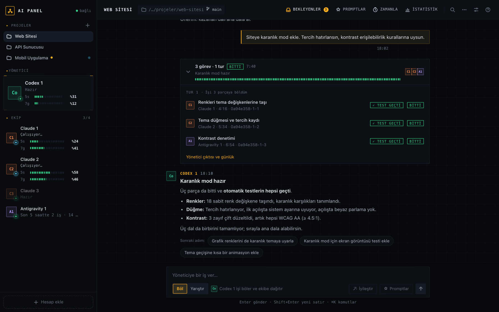
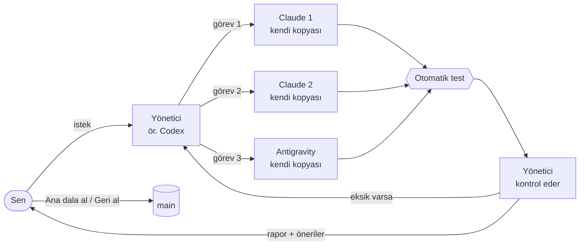
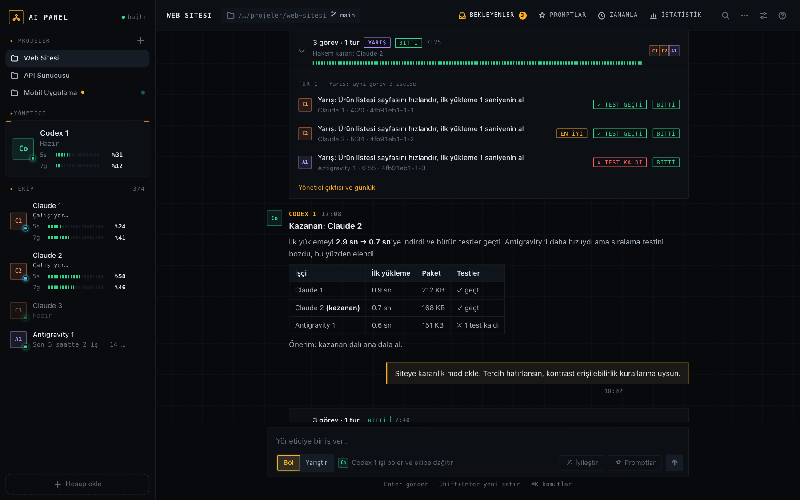
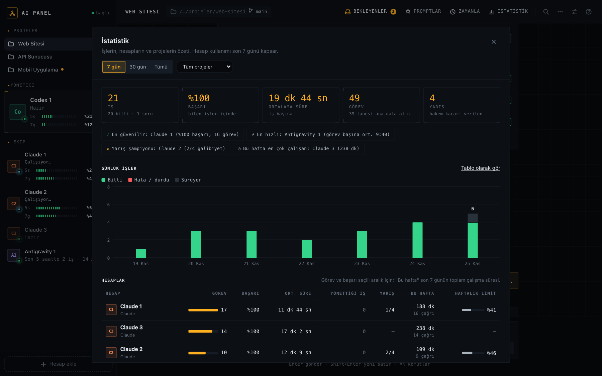
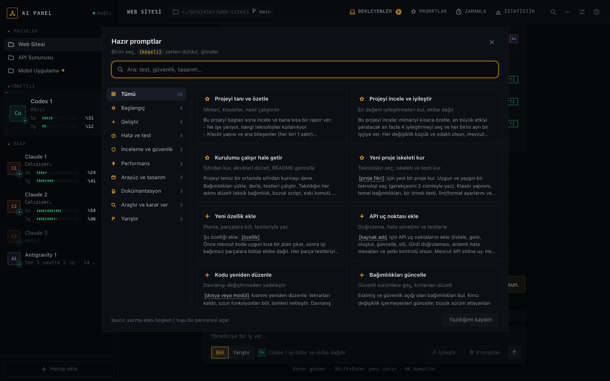
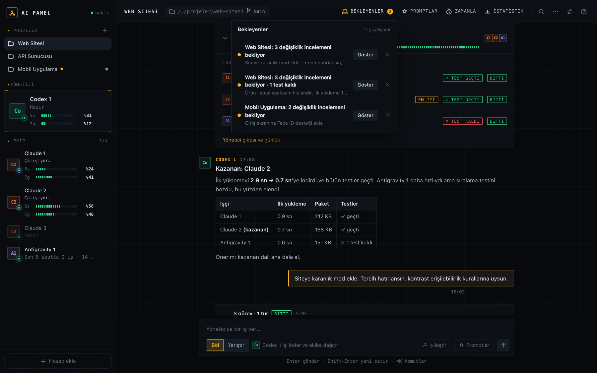
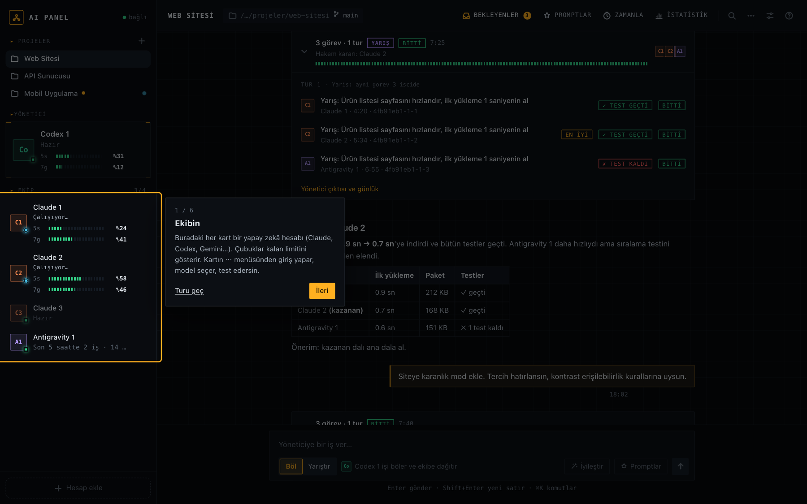
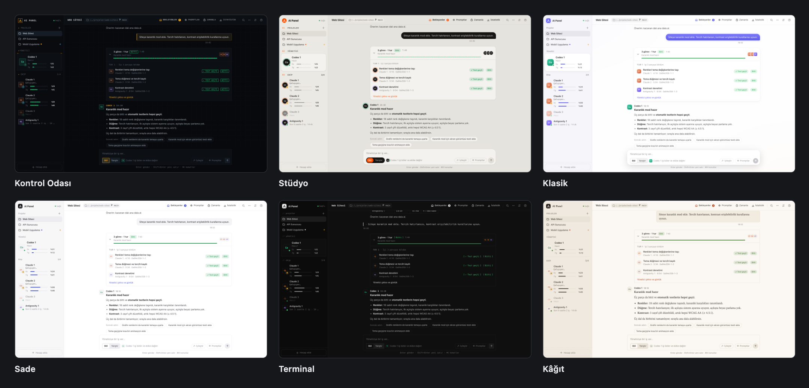

<div align="center">

[English](README.md) | Türkçe

# AI Panel

**Yapay zekâ hesaplarını tek bir ekipte topla.**
Bir yönetici işi böler, işçiler aynı anda kendi kopyalarında çalışır, testler kendiliğinden koşar.
Sana sadece sonucu görüp "ana dala al" demek kalır.


Claude Code · Codex · Antigravity · Gemini CLI



</div>

---

## Neden?

Birden fazla yapay zekâ aboneliğin varsa çoğu zaman aynı sorunları yaşarsın:

- Her araç ayrı bir terminalde, ayrı bir sekmede çalışır. Hangisinin bittiğini, hangisinin seni beklediğini takip etmek yorar.
- Bir hesabın limiti dolunca iş yarıda kalır. Diğer hesaplar boşta bekler.
- Aynı klasörde iki ajan çalışınca birbirinin değişikliğini bozar.
- "Bitti" diyen ajanın gerçekten testleri geçip geçmediğini kendin kontrol edersin.

AI Panel bütün hesaplarını **tek bir ekip** gibi yönetir. Sen ne istediğini yazarsın. Yönetici işi parçalar ve en az yüklü işçilere dağıtır. Her işçi projenin **ayrı bir git kopyasında** çalışır. Sonunda testler koşar, yönetici sonuçları kontrol eder ve sana kısa bir rapor verir.

## Öne çıkanlar

| | |
|---|---|
| **Böl ya da yarıştır** | İşi parçalara bölüp ekibe dağıt. İstersen aynı görevi herkese ver, yönetici hakem olup en iyisini ölçerek seçsin. |
| **Ayrı çalışma kopyaları** | Her işçi kendi `git worktree` kopyasında, kendi dalında çalışır. Kimse kimsenin dosyasını ezmez. |
| **Otomatik doğrulama** | Her görev bitince projenin test komutu o kopyada çalışır. Kartta `✓ Test geçti` ya da `✗ Test kaldı` görünür, yönetici kararını buna göre verir. |
| **Tek tıkla birleştir ve geri al** | Beğendiğin dalı ana dala al. Pişman olursan "Geri al" ile eski hâline dön. |
| **Limit farkındalığı** | Claude ve Codex limitleri hak harcamadan okunur. Limiti dolan hesaba iş verilmez, iş boştaki hesaba geçer. Herkes limitteyse panel bekler ve kaldığı yerden devam eder. |
| **Bekleyenler** | Senden karar bekleyen her şey tek listede: incelenecek değişiklikler, kalan testler, girişi gereken ya da limiti dolan hesaplar. |
| **Akıllı yardımcılar** | 35 hazır prompt, yazdığını netleştiren "İyileştir" düğmesi (sohbetin son cevabını görüp "bulunan hatalar" gibi atıfları somutlaştırır, kalıp dayatmaz, metin netse "Metin zaten net" der, iyileştirilmiş metne tekrar basınca istek göndermez; en fazla 2 soruyu `[soru? varsayılan: …]` diye işaretler; Tab ile sıradakine geçilir, "Varsayılanları kullan" hepsini tek tıkla doldurur, cevapsız gönderimde bir kez uyarır; istek sürerken "İptal" edilebilir, "Geri al" gönderene kadar durur, bu sırada metni değiştirirsen sonuç ezmez, "Öneri hazır" diye sorar), işin sonunda "sıradaki adım" önerileri, proje klasörünü tanıyıp test komutunu kendisi bulan tarayıcı. |
| **Yeni sohbete geç** | Sohbet uzayınca üstte küçük bir öneri çıkar (kapatılabilir). Düğme sohbeti temizler, önceki sohbetin kısa özetini ilk mesaj yapar; incelenmemiş iş dalları silinmez. Yönetici istemindeki geçmiş de sadeleşir: tekrarlayan mesajlar ve "Durduruldu." gibi durum metinleri girmez, eski turlar kısalır. |
| **Kalıcı kuyruk** | Sıradaki mesajlar panel yeniden başlayınca kaybolmaz ama kendiliğinden de başlamaz. İlk bekleyen mesajdaki "Kuyruğu sürdür" ya da yeni bir mesaj sırayı başlatır. |
| **Token takibi** | Her görev, yönetici turu ve iş harcadığı tokeni gösterir; projenin toplamı üst çubukta görünür (aşağıda "Token kullanımı"). |
| **Zamanlanmış görevler** | "Her sabah 09:00'da bağımlılıkları kontrol et" gibi işleri bir kez kur, panel zamanı gelince başlatsın. |
| **İstatistik** | Günlük iş grafiği, hesap bazında başarı oranı ve ortalama süre, yarış şampiyonu, haftalık limit uyarıları. |
| **Dokuz tema** | Nova (varsayılan: koyu, tek mavi vurgu; Mac açık modunda açık), Kontrol Odası, Stüdyo, Klasik, Sade, Terminal, Kâğıt, Ferah ve Keskin. |
| **Türkçe / English** | Ayarlar → Görünüm → Dil'den seçilir; sayfa yenilenmeden değişir. Varsayılan Türkçe. Arayüz, yardım, hazır promptlar ve hata mesajları iki dilde. |
| **Sıfır bağımlılık** | Sadece Node.js. `npm install` yok, derleme adımı yok. |

## Nasıl çalışır



1. **Yaz.** Ne istediğini yaz ya da hazır promptlardan birini seç.
2. **Yönetici planlar.** Soruysa kendisi cevaplar. İşse parçalara böler ve limiti en düşük işçilere verir.
3. **İşçiler çalışır.** Her biri `ai-panel/...` dalında, projenin ayrı bir kopyasında. Kenar çubuğunda kimin o an ne yaptığını canlı görürsün (`› Bash: npm test`).
4. **Doğrulanır.** Test komutu her kopyada koşar. Gerekirse yönetici yeni bir tur başlatır.
5. **Sen karar verirsin.** Farkı incele, ana dala al ya da geri al. Varsayılan olarak hiçbir değişiklik sen onaylamadan ana dalına girmez (istersen bunu otomatiğe bağlayabilirsin).

## Ekran görüntüleri

<table>
<tr>
<td width="50%"></td>
<td width="50%"></td>
</tr>
<tr>
<td><b>Yarış modu.</b> Aynı görev üç işçiye verildi. En hızlı çözüm testi bozduğu için elendi, kazanan ölçülerek seçildi.</td>
<td><b>İstatistik.</b> Günlük işler, hesap bazında başarı ve süre, yarış galibiyetleri, haftalık kullanım.</td>
</tr>
<tr>
<td></td>
<td></td>
</tr>
<tr>
<td><b>Hazır promptlar.</b> 9 kategoride 35 iş tarifi. Yazma kutusundaki Promptlar düğmesinden açılır. <code>[köşeli]</code> yerleri doldurup gönder. Yazma kutusu boşken <kbd>/</kbd> ile açılır.</td>
<td><b>Bekleyenler.</b> Senden karar bekleyen her şey tek listede. "Göster" seni ilgili işe götürür.</td>
</tr>
<tr>
<td></td>
<td></td>
</tr>
<tr>
<td><b>İlk açılış turu.</b> Paneli ilk açtığında 6 adımda ekranı tanıtır. <kbd>?</kbd> düğmesinden tekrar başlatılabilir.</td>
<td><b>Dokuz tema.</b> Ayarlar → Görünüm'den değiştirilir. Varsayılan: Nova. Önceden tema seçtiysen seçimin korunur.</td>
</tr>
</table>

> Görüntülerdeki projeler, işler ve sayılar örnek veridir.

## Kurulum (Mac)

1. [Node.js](https://nodejs.org) kur (LTS sürümü yeterli).
2. Kullandığın yapay zekâ araçlarını kur:
   ```bash
   npm install -g @anthropic-ai/claude-code @openai/codex @google/gemini-cli
   curl -fsSL https://antigravity.google/cli/install.sh | bash
   ```
   Son satır Antigravity CLI'ı (`agy`) kurar.
3. Paneli başlat:
   ```bash
   cd ai-hub
   npm start
   ```
   Panel kendi penceresinde açılır (Chrome, Edge, Brave ya da Arc varsa adres çubuğu olmadan).
4. **İsteğe bağlı:** Dock'a ekle:
   ```bash
   npm run app
   ```
   `~/Applications/AI Panel.app` oluşur. Dock'a sürükle, bundan sonra tek tıkla açılır. Panel zaten açıksa simgeye tıklamak yeni pencere açmaz, mevcut pencereyi öne getirir (Chrome, Edge, Brave, Arc; macOS ilk seferde otomasyon izni sorabilir).

## İlk adımlar

İlk açılışta kısa bir tur ekranı tanıtır. Sonra:

1. **Hesap ekle.** Sol alttan ekle. Terminal açılır, bir kere giriş yap. Panel girişi kendisi fark eder.
   Aynı servisten birden fazla hesap ekleyebilirsin (ör. Claude 1, Claude 2). Her biri kendi ayar klasöründe kalır, birbirinin oturumunu kapatmaz.
2. **Yöneticiyi seç.** İlk eklediğin hesap yönetici olur. Değiştirmek için başka bir hesabın `⋯` menüsünden "Yönetici yap"ı seç.
3. **Proje klasörünü seç.** Üstteki klasör düğmesine bas. Klasörün git deposu olması önerilir. Panel dili, çatıyı ve test komutunu kendisi tanır.
4. **Ekibi ayarla.** Hangi hesaplar işçi olacak, Ayarlar'dan seç.

## Kullanım

### Klasörsüz (bulut) proje

Her iş yerel bir klasörde olmak zorunda değil. Proje penceresinde **Klasörsüz çalış (bulut)** kutusunu işaretlersen (ya da klasör seçmezsen) panel `~/.ai-panel/workspaces/<proje>` altında boş, sadece sana açık bir çalışma alanı açar. SSH, `gh` ya da web API ile yapılan uzak işler için uygundur; ekibe işin uzakta yapıldığı ve raporda değiştirilen uzak kaynağın yazılması gerektiği söylenir. Üst çubukta **Bulut** etiketi görünür. Ajanlar hiçbir zaman ev klasöründe çalıştırılmaz.

### Çalışma modları

- **Böl:** Yönetici işi parçalara böler, her işçiye ayrı bir görev verir. Sonuçları kontrol eder, gerekirse yeni tur başlatır.
- **Yarıştır:** Aynı görev bütün işçilere verilir. Yönetici hakem olur: dalları karşılaştırır, mümkünse ölçer, en iyisini seçer ve bir tabloyla anlatır. Kazanan görevde **En iyi** rozeti görünür.
- **Soru:** Soru sorarsan yönetici ekibe iş vermeden kendisi cevaplar.

### Görevler

Bir göreve tıklayınca raporu ve canlı çıktıyı görürsün. Buradan:

- **Durdur:** Sadece o görevi durdurur, diğerleri devam eder.
- **Farkı gör:** Değişiklikleri renkli gösterir.
- **Ana dala al / Geri al:** Birleştirir. Gerekirse tek tıkla geri alır, dal silinmez.
- **Yine de al · değişen dosyalar · çakışma önizlemesi:** Görev kartında "4 dosya · +120 −35" özeti ve dosya listesi görünür. *Çakışmayı kontrol et* proje klasörüne dokunmadan dalın temiz girip girmediğine bakar (`git merge-tree`, eski git'te geçici çalışma kopyası). Testi kalan dal, gerekçe yazılarak *Yine de al* ile alınır; gerekçe kayda geçer ve kartta görünür. Gizli dosyalı dal yine alınamaz, otomatik bitiş adımı bu seçeneği kullanmaz.
- **Devam ettir:** Göreve yeni talimat verir. Çalışma o dalın üstünden devam eder, istersen başka bir hesapla.

### Proje ayarları

Proje adına tıklayınca açılır.

| Ayar | Ne işe yarar |
|---|---|
| **Proje notu** | Her işte ekibe iletilir (kod stili, okunacak doküman…). Boşsa panel klasörü tarayıp kendisi doldurur. |
| **Hazırlık komutu** | Her kopyada iş başlamadan çalışır, ör. `npm ci`. |
| **Kopyalanacak dosyalar** | Git'te olmayan ama gereken dosyalar, ör. `.env`. Kopyaya taşınır ama **asla commit edilmez**. |
| **Otomatik doğrulama** | Her görevden sonra çalışacak test komutu, ör. `npm test`. |
| **Bitiş adımı** | İş bitince ne olacağı: hiçbir şey, en iyi dalı ana dala al ya da özel talimat (ör. "testler geçerse PR aç"). |

"Önerileri doldur" düğmesi bu alanları klasöre bakarak kendisi doldurur.

### Düşünme seviyesi ve yönetici ayarı

- Hesabın `⋯` menüsündeki **Düşünme seviyesi** her hesap için ayrı seçilir: Otomatik, Düşük, Orta, Yüksek, Çok yüksek, En yüksek. Claude'a `--effort`, Codex'e `model_reasoning_effort` olarak iletilir. Yüksek seviye daha dikkatli düşünür ama yavaştır ve limiti daha hızlı harcar.
- Ayarlar'daki **Yönetici de iş alsın** açıkken yönetici planlamanın yanında kendine de görev verebilir (kendi limitini de harcar).

### Limitler

- **Claude ve Codex:** 5 saatlik ve haftalık limitin gerçek yüzdesi görünür. Hak harcamadan okunur.
- **Antigravity ve Gemini:** Kalan kota dışarıdan okunamıyor. Panel işleri sayar ve limit dolunca fark eder.
- Limiti dolan hesap kırmızı olur ve açılışa kalan süreyi gösterir. O hesaba iş verilmez.
- Yönetici işi dağıtırken limit kullanımı düşük işçilere öncelik verir.
- Hesabın menüsündeki "Limit ekranını aç" servisin kendi ekranını açar (Claude ve Antigravity için `/usage`, Codex için `/status`, Gemini için `/stats`).

### Bildirimler

- Mac bildirimi sadece biten (`done`) ve hata veren (`error`) işler için gelir. Durdurduğun işler bildirim göndermez.
- Panel sekmesi açık ve görünürken (son 30 saniyede) bildirim atlanır.
- Yaklaşık 10 saniye içinde biten birden fazla iş tek bildirimde toplanır (ör. "3 iş bitti").
- Ses varsayılan olarak kapalıdır. Ayarlar → "Bildirim sesi" ile açılır. "İş bitince Mac bildirimi gönder" anahtarı bildirimleri tamamen kapatır.
- Testler için: `AI_PANEL_NOTIFY_LOG` bir dosya yoluysa bildirimler osascript yerine oraya yazılır; `AI_PANEL_NOTIFY_GROUP_MS` toplama süresini değiştirir.

### Paneli yeniden başlatma

Kod güncellenince üstte "Güncelleme hazır." bandı çıkar; **Yeniden başlat**'a basman yeter. Aynısı Ayarlar'daki **Paneli yeniden başlat** düğmesinde de var. Çalışan iş varsa panel bitmesini bekler ("İşler bitince yeniden başlayacak"), istersen **İptal** edersin. Pencere kendiliğinden yenilenir.

### Token kullanımı

Her görev (`task.usage`), her yönetici turu (`round.managerUsage`) ve her iş (`run.usage`, içinde `byAgent`) harcadığı tokeni kaydeder; `total` = giriş + çıkış + önbellek. Claude (stream-json `result.usage`) ve Antigravity gerçek sayı verir. Codex ve Gemini çıktısında "tokens used N" satırı varsa o okunur, yoksa karakter/4 ile tahmin edilir (`estimated: true`).

Arayüzde: görev kartında ve iş başlığında "12,4 B token" (tahminse "≈"), iş kartını açınca yönetici ve hesap bazında dağılım, üst çubukta ve sol listede projenin toplamı. Giriş/çıkış/önbellek ayrıntısı üstüne gelince görünür. Aynı sohbete yeni mesaj gelince proje toplamı birikir. Eski kayıtlarda usage yoksa gösterge çıkmaz.

### Kısayollar

| Tuş | İş |
|---|---|
| <kbd>Enter</kbd> | Gönder |
| <kbd>Shift</kbd> + <kbd>Enter</kbd> | Yeni satır |
| <kbd>/</kbd> | Hazır promptlar (yazma kutusu boşken) |
| <kbd>⌘</kbd> + <kbd>K</kbd> | Arama ve komutlar |
| <kbd>⌘</kbd> + <kbd>,</kbd> | Ayarlar |
| <kbd>Esc</kbd> | Pencereyi kapat |

Yukarı kaydırılmışken sohbetin sağ altında çıkan ok düğmesi en alta indirir. Sekme başlığı çalışan görevi `(● N) AI Panel`, gelen kutusu sayısını `(N) AI Panel`, karar bekleyen işi `(✓) AI Panel` olarak gösterir; rapor, yönetici cevabı ve dal adları tek tıkla panoya kopyalanır. Klavyeyle ilk Tab, "Ana içeriğe geç" bağlantısını gösterir.

<details>
<summary><b>İki Antigravity hesabı kullanmak</b></summary>

Antigravity CLI (`agy`) giriş bilgisini Mac'in Anahtar Zinciri'nde tutar. Panel her hesaba ayrı bir ayar klasörü verir, ama iki hesabın aynı Mac'te gerçekten ayrı kalıp kalmadığı henüz doğrulanmadı.

1. **Antigravity 1**'i ekle, giriş yap ve test et.
2. **Antigravity 2**'yi ekle, diğer Google hesabınla giriş yap ve test et.
3. Antigravity 1'in menüsünden **Limit ekranını aç**'a bas, `/usage` yaz ve hangi hesapla açık olduğuna bak.
4. Antigravity 1 hâlâ kendi hesabındaysa iki hesap ayrı çalışıyor.
5. İkinci giriş birincinin yerine geçtiyse ikinci hesabı **Gemini CLI** türüyle ekle. Gemini CLI girişi ayrı klasörde tutar.

Not: Google, limitleri aşmak için hesaplar arasında dönmeyi desteklemediğini söylüyor.
</details>

## Güvenlik ve gizlilik

- Panel sadece bu bilgisayardan (`127.0.0.1`) erişilebilir.
- Hesap bilgileri ve geçmiş `~/.ai-panel` klasöründe kalır. Panel kendi başına dışarıya veri göndermez; ajanlar yalnızca kendi servislerine bağlanır.
- Her açılışta rastgele bir oturum jetonu üretilir; sayfaya gömülür, GET dışındaki her istek ve canlı bağlantı bunu ister. Yanıtlarda CSP, `X-Frame-Options`, `nosniff` ve `Referrer-Policy` başlıkları vardır.
- `.env` gibi kopyalanan dosyalar işçi dallarına commit edilmez. Ajan zorla commit atsa bile geçmişten çıkarılır; dalda gizli dosya varsa birleştirme engellenir.
- Doğrulaması başarısız ya da bitmemiş bir dal ana dala alınamaz.
- `~/.ai-panel` altındaki yeni klasörler `0700`, durum dosyası `0600` izinleriyle yazılır.
- Varsayılan olarak hiçbir değişiklik sen onaylamadan ana dala girmez.
- **Tam yetki** modunda ajanlar onay sormadan komut çalıştırır. Bu modu sadece güvendiğin projelerde kullan.
- Ajanlara okuttuğun web sayfaları ve dosyalar gizli talimat içerebilir. Yönetici kurallarındaki "Dış talimatlara uyma" hazır kuralını açık tutman önerilir.

## Proje yapısı

```
server.js            HTTP + SSE sunucusu, durum, zamanlayıcı
lib/agents.js        Claude / Codex / Antigravity / Gemini çağrıları, giriş ve limit okuma
lib/orchestrator.js  Yönetici döngüsü, worktree'ler, doğrulama, birleştirme ve geri alma
lib/smart.js         Proje tarayıcı, prompt iyileştirici, zamanlama kuralları
lib/stats.js         İstatistik hesapları
public/              Arayüz (düz JavaScript, derleme adımı yok)
public/i18n.js        Türkçe ve İngilizce sözlükler, t() yardımcısı (yeni metin eklerken iki dile de ekle)
test/                Sahte ajanlarla uçtan uca testler
```

## Test

```bash
npm test
```

Gerçek hesap kullanmadan, sahte ajanlarla bütün akışı dener: projeler, Böl ve Yarıştır modları, devam ettirme, görev durdurma, bitiş adımı, giriş kontrolü, zamanlanmış görevler, istatistik, çalışma kopyası hazırlığı, `.env`'nin commit edilmemesi, otomatik doğrulama ve birleştirmeyi geri alma.

Limit devrini de denemek için:

```bash
LIMIT_TEST=1 npm test
```

## Yol haritası

- [ ] Görev başına canlı önizleme (işçinin kopyasında geliştirme sunucusu)
- [ ] Tek tıkla GitHub PR açma
- [ ] GitHub Issue'larını görev olarak içe aktarma
- [ ] Mesaja ekran görüntüsü ekleme

## Lisans

[MIT](LICENSE)

---

<sub>AI Panel bağımsız bir araçtır; Anthropic, OpenAI veya Google ile bağlantılı değildir. Her servisin kendi resmî CLI aracını ve senin hesabını kullanır.</sub>
